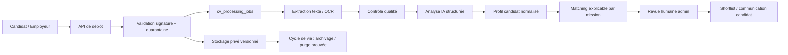

# Audit backend — traitement des CV et candidatures

**Projet :** Dr. Ahmed Ben Lallahom / Hippocampus Consulting  
**Périmètre :** recrutement international, candidatures VVIP/Offshore, stockage des CV, analyse IA, matching, administration, rétention et briefs Employeurs.  
**Date :** 17 août 2026  
**Niveau de maturité actuel :** fondation fonctionnelle et prometteuse, à faire évoluer vers une architecture de traitement documentaire fiable, observable et réellement industrialisable.

> **Conclusion exécutive.** Le site dispose déjà des bons composants métier : dépôt sécurisé à taille limitée, stockage privé, analyse structurée, supervision humaine affichée, journalisation de plusieurs actions administratives, profils de matching et purge planifiée. Les principales améliorations à engager ne concernent donc pas l’interface publique, mais la **fiabilité du pipeline de traitement**, la **cohérence du modèle de données**, la **suppression physique des documents**, la **traçabilité de bout en bout** et la **qualité de la présélection pour des missions critiques**.

## 1. Architecture observée

Le parcours actuel est cohérent pour un premier déploiement : le candidat envoie son formulaire multipart et son CV, le serveur vérifie le type déclaré et la taille, stocke le fichier en zone privée, crée une candidature, adresse les notifications, puis extrait et analyse le CV. Les administrateurs disposent d’un listing, de filtres, d’un téléchargement avec URL signée, d’une réanalyse et d’une action d’effacement. Les candidatures VVIP sont marquées dans la spécialité déclarée et le dépôt Employeurs crée des briefs séparés.

| Domaine | État actuel | Points positifs | Limite principale |
|---|---|---|---|
| Dépôt de CV | PDF, DOC et DOCX, limite de 5 Mo, champ leurre anti-bot | Expérience candidat simple, contrôle initial de type et taille | Validation de contenu et analyse antivirale absentes |
| Stockage | Objet privé avec URL de lecture signée | Pas d’exposition publique directe du CV | Aucun mécanisme de suppression d’objet disponible dans le flux RGPD |
| Extraction | PDF textuel, DOCX, DOC et fallback vision pour PDF scanné | Bonne couverture documentaire initiale | OCR limité aux trois premières pages, sans métrique de confiance |
| Analyse IA | Sortie JSON stricte, synthèse, compétences, expériences normalisées, score et avertissements | Consignes de non-discrimination et revue humaine explicites | Traitement synchrone, sans file, reprise, versionnement ni état détaillé |
| Matching | Pays, spécialité, score, langues et compétences | Match profiles configurables | Filtrage complémentaire en mémoire, coûteux à grande échelle |
| Administration | Statut, note, CV, réanalyse, modèles d’e-mails, effacement | Fonctionnel pour un volume limité | Pipeline trop court et fiche candidat incomplète |
| Rétention | Job quotidien d’archivage et journal d’audit | Première automatisation de cycle de vie | Archivage seulement ; la donnée et le fichier ne sont pas effectivement détruits |

## 2. Points forts à conserver

La solution applique déjà plusieurs choix pertinents. Le modèle IA produit un objet structuré, évite les inférences sur les caractéristiques protégées et présente ses résultats comme une aide à la revue humaine. Cette approche est alignée avec le principe de pertinence des données collectées et avec l’exigence de transparence mise en avant par la CNIL pour le recrutement.[1]

L’accès administratif aux CV se fait par URL signée et les actions de téléchargement, de réanalyse, d’envoi d’e-mail, de changement de statut, de purge et d’effacement sont journalisées. La conservation comporte une échéance et un job programmé. Ces fondations doivent être renforcées, non remplacées.

## 3. Constats et risques prioritaires

### 3.1 Risque critique — dérive entre le schéma, la base réelle et le code serveur

Les colonnes `availability`, `mobility` et `certifications` sont utilisées par l’endpoint de dépôt et existent dans la base après modification SQL, mais elles ne figurent pas dans le modèle Drizzle actuellement lu. De même, la table `client_briefs` est créée par SQL brut alors qu’elle n’est pas représentée par le schéma typé. Cette dérive rend les migrations futures incertaines, fragilise le type-safety et favorise les incidents lors d’une restauration ou d’un nouvel environnement.

**Recommandation immédiate :** intégrer toutes les structures réelles dans `drizzle/schema.ts`, générer une migration idempotente, vérifier l’environnement de production et supprimer les écritures SQL brutes lorsque Drizzle peut assurer la cohérence.

### 3.2 Risque critique — suppression RGPD incomplète des CV

L’effacement administratif supprime la ligne SQL mais ne détruit pas l’objet du stockage : le CV devient inaccessible depuis l’application, sans preuve de suppression physique. De même, le job de rétention archive les dossiers arrivés à échéance mais ne déclenche pas une suppression définitive ou une anonymisation ultérieure.

La CNIL rappelle que les données de recrutement ne doivent pas être conservées indéfiniment et qu’une durée cohérente et justifiée doit être définie en amont.[1] Lorsqu’un dossier est conservé dans un vivier, le candidat doit être informé et son accord est requis ; la CNIL indique la référence de deux ans après le dernier contact, sauf accord formel pour une durée supérieure.[2]

**Recommandation immédiate :** ajouter au service de stockage une capacité de suppression d’objet, puis mettre en œuvre un processus à deux étapes : **archivage restreint** à l’échéance, puis **suppression documentée du fichier et anonymisation/suppression de la ligne** après un délai de grâce défini. Chaque transition doit produire un audit log avec identifiant de dossier et résultat technique.

### 3.3 Risque élevé — traitement IA exécuté dans le chemin de requête

Après l’enregistrement de la candidature, l’extraction, le fallback vision et l’analyse LLM sont attendus dans le même flux applicatif. Une analyse peut donc rallonger la réponse, échouer de manière silencieuse après la création de la candidature, ou être abandonnée en cas de redémarrage. La réanalyse administrative télécharge et traite également le fichier dans la requête tRPC.

**Recommandation :** créer une file de traitements `cv_processing_jobs` et un état de traitement distinct de l’état de recrutement. Les phases recommandées sont `received`, `quarantined`, `validated`, `extracting`, `analyzing`, `completed`, `needs_review`, `failed`, `deleted`. Chaque tentative doit enregistrer son nombre, son horodatage, sa durée, le code d’erreur et la prochaine date de reprise. L’interface admin doit afficher ces états sans bloquer la consultation du dossier.

### 3.4 Risque élevé — validation documentaire insuffisante avant stockage et IA

Le serveur vérifie une extension et un type MIME fourni par le navigateur, avec une limite de taille. Il ne contrôle pas la signature binaire réelle du document, ne met pas les fichiers en quarantaine et n’exécute pas de détection de contenu malveillant. Pour une plateforme manipulant des documents externes, cela crée un risque technique et opérationnel.

**Recommandation :** ajouter une étape de quarantaine avec : validation par signature (« magic bytes »), contrôle de cohérence extension/MIME, anti-malware par service spécialisé ou environnement isolé, limite du nombre de pages, limite de texte extrait et rejet des fichiers chiffrés ou corrompus. Le CV ne doit passer en état `validated` qu’après ces contrôles.

### 3.5 Risque élevé — OCR trop limité et absence de qualité mesurée

Le fallback multimodal ne traite actuellement que les trois premières pages d’un PDF scanné. Pour un CV de six pages, des diplômes, certifications ou expériences situés à la fin peuvent être ignorés. Le système ne conserve ni niveau de confiance, ni pages traitées, ni version de l’OCR.

**Recommandation :** stocker `extraction_method`, `processed_page_count`, `total_page_count`, `extraction_confidence`, `ocr_model_version` et `extraction_warnings`. L’interface doit signaler explicitement « OCR partiel » ou « CV nécessite une revue manuelle ». Le nombre de pages analysées peut être configuré selon le type de poste, avec une seconde passe à la demande de l’administrateur.

### 3.6 Risque élevé — matching limité et peu explicable au niveau métier

Le score IA est utile comme signal de priorité, mais le matching actuel utilise une logique de correspondance textuelle simple, puis filtre certains critères en mémoire avec une limite de 1 000 enregistrements. Cette stratégie crée des limites de performance et peut fournir une vue partielle si le volume croît. Les critères médicaux et VVIP ne sont pas encore séparés en données atomiques.

**Recommandation :** normaliser les entités clés : certifications, langues avec niveau, disponibilités, mobilité, pays autorisés, expériences offshore/VVIP, spécialités, sous-spécialités et formations. Créer un **score de compatibilité explicable par critère** : disponibilité, certification obligatoire, expérience similaire, langue, localisation et score documentaire. Le score global doit être accompagné d’une ventilation, jamais utilisé comme seuil automatique d’exclusion.

### 3.7 Risque moyen — audit trail utile mais trop minimal

Le journal existant recense les actions sensibles, mais son contenu est un JSON opaque et il ne couvre pas toutes les opérations importantes : consultation détaillée du profil, changements de notes, échecs d’e-mail, échecs de stockage, transitions de traitement et consultation d’un brief Employeur. Il ne contient pas de corrélation entre une action, un job et un incident.

**Recommandation :** standardiser le log avec un `eventId`, `actorType`, `actorId`, `applicationId`, `briefId`, `jobId`, `action`, `outcome`, `reasonCode`, `metadataVersion`, `createdAt`. Ne jamais consigner le contenu intégral du CV ou des données sensibles dans les métadonnées.

### 3.8 Risque moyen — briefs Employeurs hors circuit métier structuré

Le formulaire Employeurs est un bon point d’entrée, mais les briefs écrits en SQL brut ne disposent pas encore d’un modèle Drizzle complet, de procédures tRPC d’administration, de filtres, de statuts détaillés, de notes sécurisées ni de lien avec une shortlist de candidats.

**Recommandation :** créer un module `clientBriefs` typé, un tableau de bord dédié et une table d’association `brief_candidates`. L’administrateur pourra alors créer une shortlist sans transmettre des dossiers complets prématurément, suivre les étapes de mission et journaliser les décisions.

## 4. Gouvernance RGPD et IA

La CNIL exige que les données collectées pour le recrutement soient adéquates, pertinentes et strictement nécessaires au poste et à l’évaluation des aptitudes.[1] Elle a récemment rappelé que la collecte de données comme le lieu de naissance, les informations familiales ou les salaires passés n’est pas justifiée au stade de la candidature générale.[3] Le produit doit donc maintenir une séparation nette entre les informations professionnelles nécessaires, les preuves de certification nécessaires à une mission donnée et les informations à ne demander qu’après la sélection et sur base juridique appropriée.

Le modèle actuel de revue humaine est un choix important. Pour renforcer la gouvernance IA, il est recommandé de créer un registre de modèles et d’analyses comprenant la version du modèle, le schéma de sortie, la version du prompt, les limitations connues, le mode d’OCR et l’horodatage. Une évaluation juridique dédiée doit aussi être documentée pour qualifier les usages d’IA liés à l’emploi au regard du cadre applicable et des lignes directrices européennes sur les systèmes à haut risque.[4]

| Garde-fou | État | Renforcement recommandé |
|---|---|---|
| Décision humaine finale | Présent dans les instructions et l’UI | Ajouter une confirmation admin obligatoire avant toute décision externe |
| Non-discrimination | Présent dans le prompt IA | Écrire des tests de régression sur les variables protégées et les réponses biaisées |
| Transparence | Mention de l’analyse automatisée | Fournir une notice candidate expliquant finalité, logique générale, limites et recours humain |
| Minimisation | Formulaire déjà professionnel | Ne rendre obligatoire aucune donnée non nécessaire à un poste concret |
| Conservation | Échéance et archivage | Ajouter purge physique, preuve de suppression et renouvellement du vivier |

## 5. Architecture cible recommandée

Cette architecture dissocie clairement l’acceptation de la candidature de son enrichissement asynchrone, ce qui rend l’expérience plus robuste et facilite les reprises après incident.

## 6. Feuille de route priorisée

| Horizon | Objectif | Livrables techniques | Résultat métier attendu |
|---|---|---|---|
| **Sprint 0 — immédiat** | Assainir la cohérence et la suppression | Schéma Drizzle complet, migrations contrôlées, `client_briefs` typé, suppression objet de stockage | Base de données fiable et RGPD actionnable |
| **Sprint 1 — 1 à 2 semaines** | Industrialiser le pipeline CV | `cv_processing_jobs`, états détaillés, reprises, métriques, quarantaine, validation binaire | Analyses fiables, pas de blocage du dépôt, incidents visibles |
| **Sprint 2 — 2 à 3 semaines** | Structurer les données et le matching | Tables certifications/langues/expériences, score par critère, filtres SQL, shortlist par brief | Recherche précise des profils VVIP et internationaux |
| **Sprint 3 — 3 à 4 semaines** | Améliorer l’opérationnel | Dashboard de briefs, suivi candidat, historique de communication, alertes, SLA | Pipeline commercial et recrutement exploitable au quotidien |
| **Sprint 4 — continu** | Gouverner et optimiser l’IA | Registre de modèles, échantillonnage qualité, tests de biais, tableaux de bord d’erreurs/coûts | IA traçable et utile, sous contrôle humain |

## 7. Les dix améliorations à lancer en priorité

1. Mettre le schéma Drizzle en conformité avec la base réellement déployée, puis ajouter une migration vérifiée.
2. Ajouter la suppression d’objet du stockage privé et une preuve de purge dans l’audit trail.
3. Créer une file de jobs persistante pour l’extraction et l’analyse, avec retries contrôlés.
4. Ajouter un statut d’analyse séparé du statut de candidature.
5. Mettre en quarantaine et valider techniquement les fichiers avant stockage définitif et analyse.
6. Conserver les métadonnées d’extraction et de modèle pour rendre chaque analyse reproductible.
7. Exposer disponibilité, mobilité et certifications dans la fiche candidat et les filtres.
8. Normaliser les certifications, langues et expériences plutôt que les conserver seulement en texte libre.
9. Construire le tableau de bord des briefs Employeurs et l’association mission–candidats.
10. Ajouter des tests d’intégration pour les chemins de succès, échec d’OCR, échec IA, purge de fichier, notifications et accès administrateur.

## 8. Indicateurs de qualité à suivre

| Indicateur | Objectif initial |
|---|---|
| Taux d’extraction utilisable | Mesurer par format et séparer OCR des PDF textuels |
| Taux d’analyses en échec | Alerte lorsque le seuil dépasse une valeur définie |
| Délai moyen dépôt → profil analysé | Suivre la performance du pipeline asynchrone |
| Pourcentage de CV nécessitant revue manuelle | Identifier les documents scannés, incomplets ou ambigus |
| Temps de traitement d’une demande RGPD | Vérifier la suppression de la ligne **et** de l’objet fichier |
| Taux de conversion brief Employeur → shortlist | Mesurer l’efficacité commerciale du nouveau parcours |
| Écart entre score IA et décision humaine | Contrôler la pertinence réelle du scoring sans automatiser la décision |

## Conclusion

Le module peut devenir une plateforme de recrutement médical internationale particulièrement différenciante. La priorité n’est pas d’augmenter davantage le nombre de champs du formulaire : elle est de construire un **pipeline traçable, asynchrone, sécurisé et explicable**, où chaque document est validé, chaque analyse est versionnée, chaque décision reste humaine et chaque donnée peut être supprimée de manière démontrable.

## Références

[1] [CNIL — Le guide du recrutement](https://www.cnil.fr/fr/le-guide-du-recrutement)  
[2] [CNIL — Un employeur peut-il conserver mon dossier ?](https://www.cnil.fr/fr/cnil-direct/question/recrutement-un-employeur-peut-il-conserver-mon-dossier)  
[3] [CNIL — Mise en demeure sur la minimisation des données de candidats](https://www.cnil.fr/fr/recrutement-la-cnil-met-en-demeure-une-societe-de-minimiser-la-collecte-de-donnees-personnelles-de)  
[4] [Commission européenne — Guidelines on the classification of high-risk AI systems](https://ai-act-service-desk.ec.europa.eu/en/guideline-explorer)
